

 

 

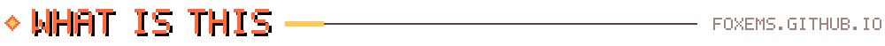

**Hi, I'm Foxems.** I watch too much anime and play too many games. Somewhere along the way, I ended up building a little pixel art playground on the web instead of a normal profile page. Inside, you'll find 15 animated worlds, a 3D fox wandering across the top of the screen, a short pixel opera, 3D voxel booster packs, an interactive 3D version of my PC setup, and a steam train carrying every title I've watched or played.

> [!TIP]
> **[Open foxems.github.io](https://foxems.github.io/)** and click around. Almost everything on the page reacts when you poke it.

 

Little 3D voxel models and sprite stacked pixel art sculpted by hand, rendered with baked shadows, clean outlines, and sharp pixel scaling so nothing blurs.

<a href="https://foxems.github.io/">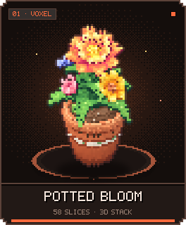</a>
<a href="https://foxems.github.io/?scene=sakura&boot=0">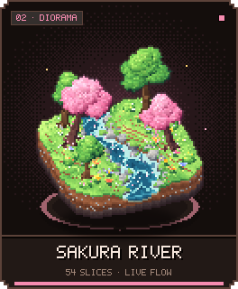</a>
<a href="https://foxems.github.io/">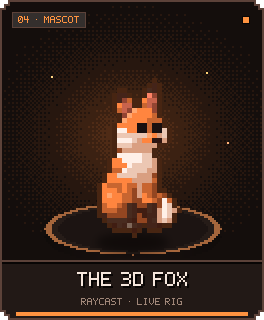</a>

 

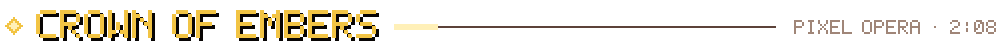

A short pixel concert hall experience with an orchestra, choir, war drums, falling rose petals, and a crowned fox watching from the royal box. It runs for about two minutes, and it is much better with headphones on.

<b><a href="https://foxems.github.io/opera/">Enter the opera →</a></b> &nbsp;·&nbsp; Press <kbd>O</kbd> anywhere on the site

 

There are 15 animated pixel worlds in total, each with its own weather, creatures, ambient sound, and day and night lighting. Watch Thorfinn and Askeladd duel on a fjord cliff, a brass orrery spin inside a snowy clock tower, rain fall over Night City, a whale breach at dusk, or a black hole bend the stars around it. **Click any scene below to jump right in.**

<a href="https://foxems.github.io/?scene=reef&boot=0">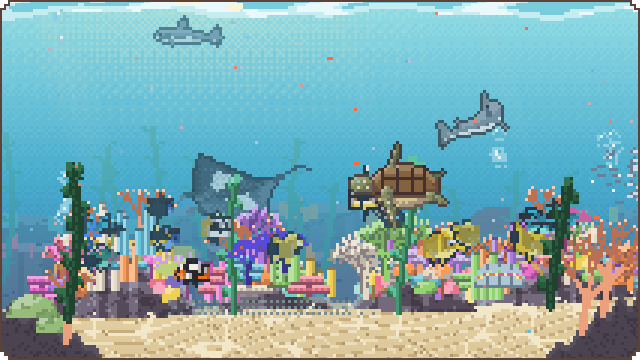</a>

<a href="https://foxems.github.io/?scene=nebula&boot=0">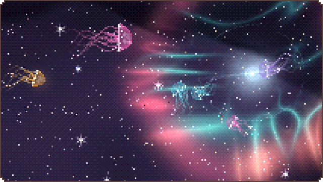</a>
<a href="https://foxems.github.io/?scene=lofi&boot=0">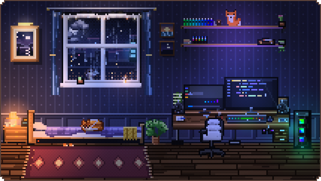</a>

<a href="https://foxems.github.io/?scene=fields&boot=0">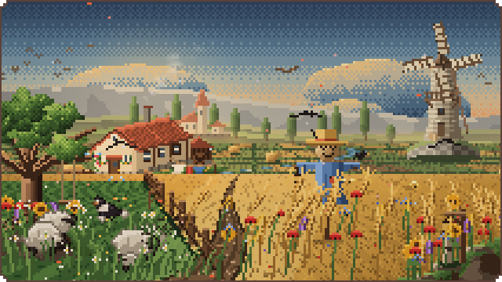</a>
<a href="https://foxems.github.io/?scene=isles&boot=0">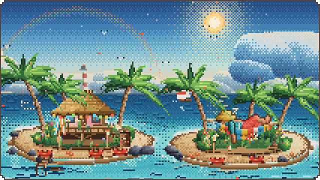</a>

 

Click my avatar or press <kbd>F</kbd> to open my five favourite anime and five favourite games as **3D holographic voxel cards**. Swipe across the top of a sealed foil pack to rip it open, spin the 3D model around, flip the card over, or switch up its aura.

<a href="https://foxems.github.io/">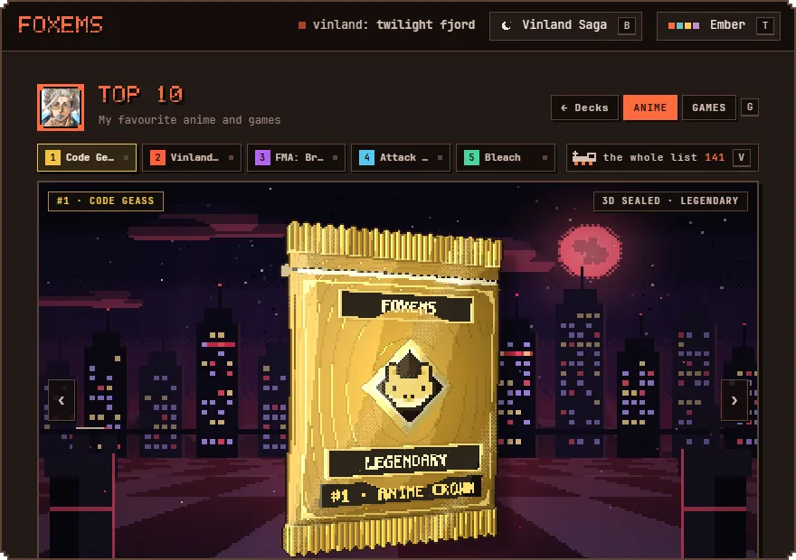</a>

 

| Rank | Tier | Anime | Games |
|:-:|:--|:--|:--|
| **#1** | `LEGENDARY` | **Code Geass: Lelouch of the Rebellion** `11/10` | **Red Dead Redemption 2** |
| **#2** | `EPIC` | **Vinland Saga** `10.5/10` | **Kingdom Come: Deliverance II** |
| **#3** | `MYTHIC` | **Fullmetal Alchemist: Brotherhood** | **Crimson Desert** |
| **#4** | `RARE` | **Attack on Titan** | **God of War Ragnarök** |
| **#5** | `RELIC` | **Bleach** | **Clair Obscur: Expedition 33** |

 

Press <kbd>I</kbd> on the site to check out my PC setup laid out like an RPG inventory screen. There are four **3D voxel dioramas** covering my Montech XR PC, dual monitors, desk gear, and walnut speakers with plants, plus a full 360° view of every single part.

 

| Slot | Gear | Spec |
|:--|:--|:--|
| **GPU** `MYTHIC` | AMD Radeon RX 9070 XT | 16 GB GDDR6 · RDNA 4 · Set Bonus: **Team Red (2/2)** |
| **CPU** `LEGENDARY` | AMD Ryzen 7 7800X3D | 8C / 16T · 96 MB 3D V Cache · 5.0 GHz |
| **Memory** `LEGENDARY` | 32 GB DDR5 | 2 × 16 GB Dual Channel · ASUS TUF B650 Plus |
| **Displays** `EPIC` | Lenovo Legion R27qe + ViewSonic VX2418C | 27" 1440p 180 Hz IPS + 24" 165 Hz Curved |

 

Every anime from my MyAnimeList and every game in my Steam library rides along in its own train car, with a pixel cover in every window. You can pause the train, drag it around, search for any title, or poke the engine.

 

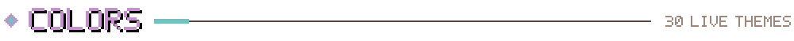

There are 30 color palettes to pick from, ranging from **Ember** and **Cyberpunk** to **Rose Pine Dawn**, with a pouring pixel transition whenever you switch. One click updates the whole UI, the 3D fox, and the world behind it.

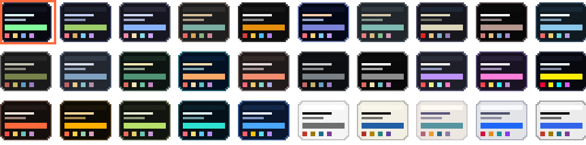

<a href="https://foxems.github.io/?scene=city&theme=cyberpunk&boot=0&sky=night">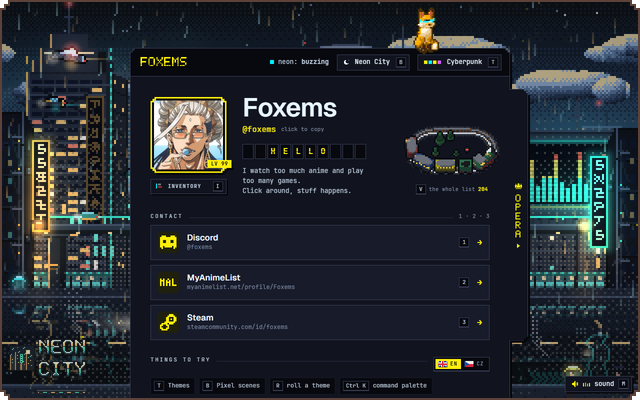</a>

<b>All 30 palettes</b>

 

Hackerman · Tokyo Night · Catppuccin · Gruvbox Dark · Matte Black · Ethereal · Everforest · Kanagawa · Last Horizon · Lumon · Miasma · Nord · Osaka Jade · Retro 82 · Ristretto · Solitude · Vantablack · Dracula · Synthwave '84 · Cyberpunk · Ember · Amber CRT · Matcha · Abyss · Cobalt · White · Flexoki Light · Rose Pine Dawn · Catppuccin Latte · Lupine

 

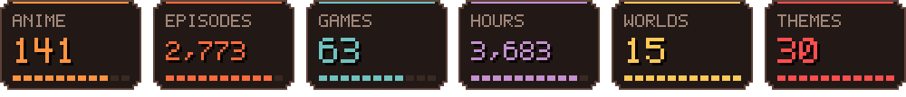

Synced from MyAnimeList and Steam into the site's pixel sprite sheets.

 

I build desktop apps, terminal tools, 3D pixel toys, and custom renderers, using whatever fits the idea best. This whole site runs with **no build step and no frameworks**, drawn straight onto HTML5 canvases one pixel at a time.

 

<b>Keyboard shortcuts on foxems.github.io</b>

 

| Key | Action |
|:-:|:--|
| <kbd>T</kbd> | cycle through all 30 color themes |
| <kbd>R</kbd> | pick a random theme |
| <kbd>B</kbd> | open the world picker for all 15 scenes |
| <kbd>F</kbd> | open the Top 10 3D booster packs |
| <kbd>I</kbd> | open the 3D PC setup and gear inventory |
| <kbd>V</kbd> | ride the steam train through all 204 titles |
| <kbd>O</kbd> | watch **Crown of Embers** (the pixel opera, best with headphones) |
| <kbd>M</kbd> | open the live Sound Deck audio mixer |
| <kbd>H</kbd> | hide the UI for clean wallpaper mode |
| <kbd>Ctrl</kbd> + <kbd>K</kbd> | open the command palette |

<b>Things to poke</b>

 

Try clicking the 3D fox on the window ledge (it wears a different outfit for every scene), the cliff in Vinland Saga to start the duel, the planets in the Brass Orrery, the neon towers in Night City, the train engine, or the 3D Crown of Embers. If something looks clickable, it probably reacts.

 

<a href="https://foxems.github.io/"></a>

