

<a href="https://foxems.github.io/">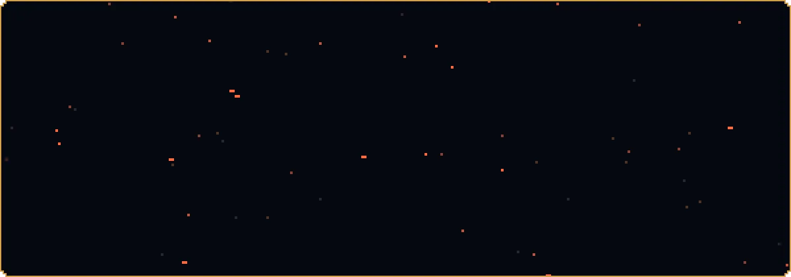</a>

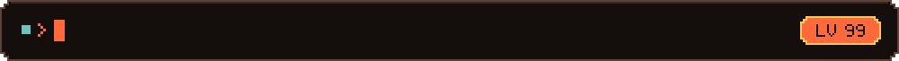

 

<a href="https://foxems.github.io/">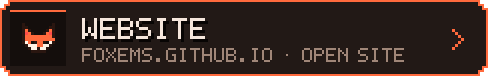</a>

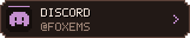
<a href="https://myanimelist.net/profile/Foxems">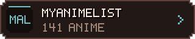</a>
<a href="https://steamcommunity.com/id/foxems">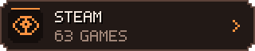</a>

 

**Hi, I'm Foxems.** I watch too much anime and play too many games, and somewhere in between I built a personal
corner of the internet that behaves less like a website and more like a living pixel-art toybox. Behind the window
sit fifteen animated worlds, a ray-cast 3D fox patrolling the top edge, a full two-minute pixel opera, 3D voxel
collectible booster packs, an interactive 3D PC rig, and a steam train carrying every title I've watched or played.

> [!TIP]
> It's not a normal "about me" page. **[Open foxems.github.io](https://foxems.github.io/) and poke around** — almost everything reacts.

 

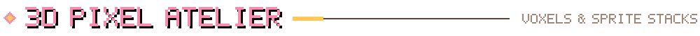

Hand-sculpted 3D voxel volumes and sprite-stacked pixel art, baked with directional ambient occlusion, quantized
turntable lighting, and single-pass outer outlines — rendered at crisp integer pixel scale with zero blur.

<a href="https://foxems.github.io/opera/">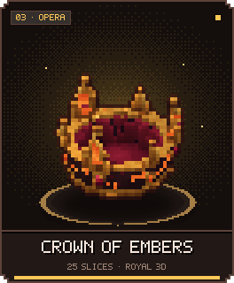</a>

 

An original pixel-art concert hall with a full orchestra, choir, war drums, falling rose petals, and one crowned fox
watching from the royal box. About two minutes long — headphones strongly recommended.

<a href="https://foxems.github.io/opera/">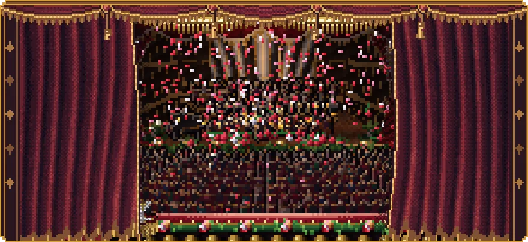</a>

<b><a href="https://foxems.github.io/opera/">Enter the opera →</a></b> &nbsp;·&nbsp; Press <kbd>O</kbd> anywhere on the site

 

Fifteen living pixel worlds, each with its own creatures, weather, soundscape, and day/night lighting. Thorfinn and
Askeladd clash blades on a fjord cliff, a brass orrery turns in a snowlit clock tower, neon rain washes over Night
City, a whale breaches at dusk, and a black hole bends the starfield. **Click any scene to step straight into it.**

<a href="https://foxems.github.io/?scene=vinland&boot=0">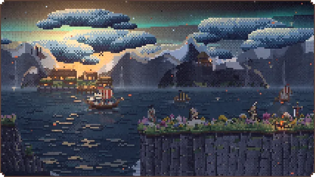</a>
<a href="https://foxems.github.io/?scene=orrery&boot=0">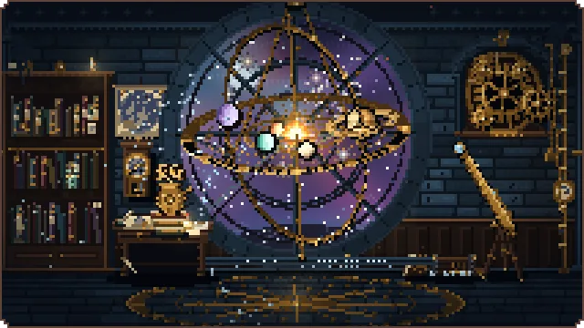</a>
<a href="https://foxems.github.io/?scene=city&boot=0">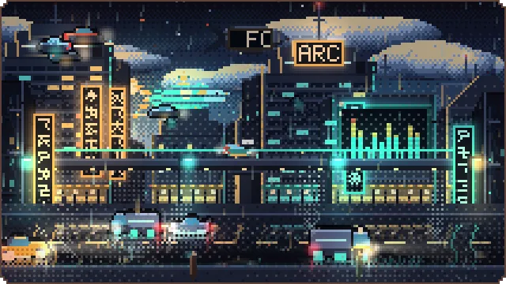</a>
<a href="https://foxems.github.io/?scene=sea&boot=0">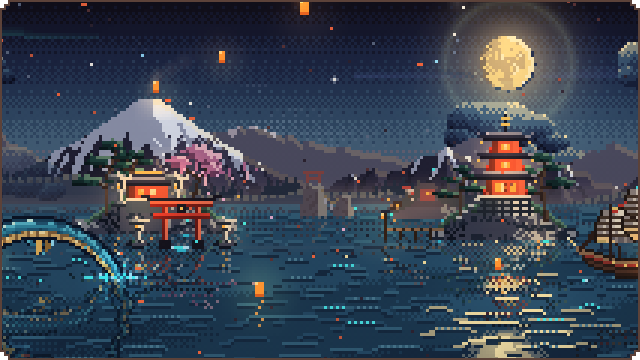</a>
<a href="https://foxems.github.io/?scene=sakura&boot=0">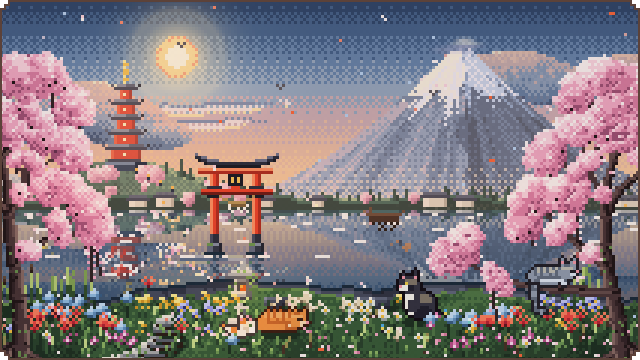</a>
<a href="https://foxems.github.io/?scene=bamboo&boot=0">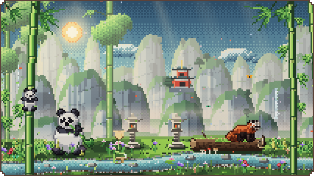</a>

<a href="https://foxems.github.io/?scene=volcano&boot=0">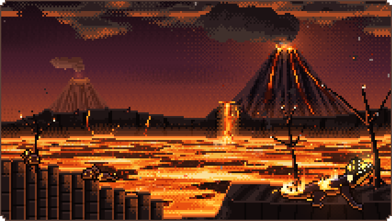</a>
<a href="https://foxems.github.io/?scene=blackhole&boot=0">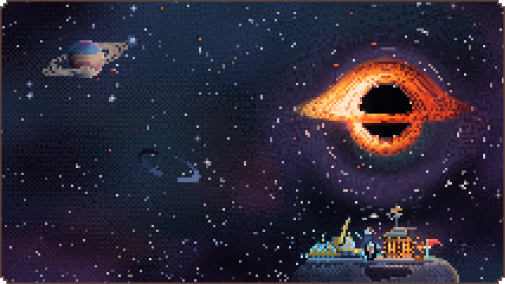</a>

<a href="https://foxems.github.io/?scene=lake&boot=0">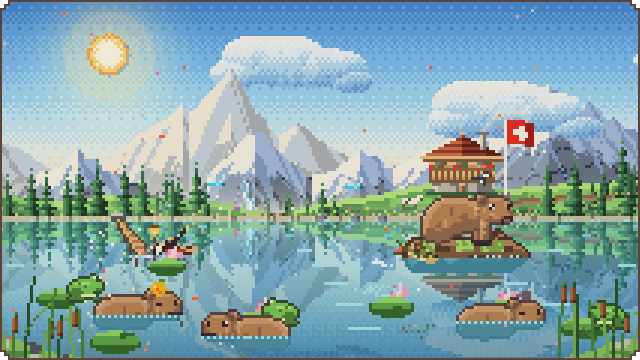</a>
<a href="https://foxems.github.io/?scene=forest&boot=0">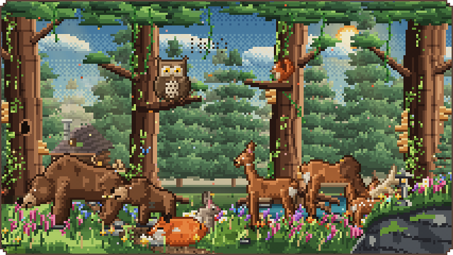</a>

 

Click my avatar (or press <kbd>F</kbd>) to unbox my five favourite anime and five favourite games as
**3D holographic voxel relic cards**. Swipe the top seam of a sealed foil pack to tear it open in a pillar of light,
orbit the sculpted 3D artifact, flip the card, or swap its aura.

 

| Rank | Tier | Anime | Games |
|:-:|:--|:--|:--|
| **#1** | `LEGENDARY` | **Code Geass: Lelouch of the Rebellion** `11/10` | **Red Dead Redemption 2** |
| **#2** | `EPIC` | **Vinland Saga** `10.5/10` | **Kingdom Come: Deliverance II** |
| **#3** | `MYTHIC` | **Fullmetal Alchemist: Brotherhood** | **Crimson Desert** |
| **#4** | `RARE` | **Attack on Titan** | **God of War Ragnarök** |
| **#5** | `RELIC` | **Bleach** | **Clair Obscur: Expedition 33** |

 

Press <kbd>I</kbd> on the site to open my RPG equipment screen: four full **3D voxel dioramas** (Montech XR pillarless
PC, dual-screen view, desk peripherals, and walnut stereo & plants) plus 360° hero inspection for every single part.

<a href="https://foxems.github.io/">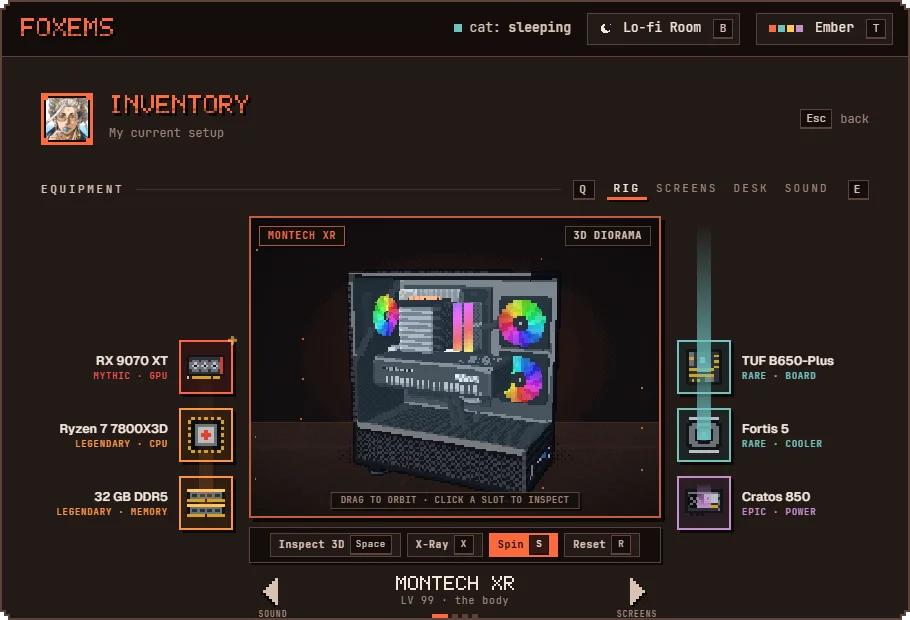</a>

 

| Slot | Gear | Spec |
|:--|:--|:--|
| **GPU** `MYTHIC` | AMD Radeon RX 9070 XT | 16 GB GDDR6 · RDNA 4 · Set Bonus: **Team Red (2/2)** |
| **CPU** `LEGENDARY` | AMD Ryzen 7 7800X3D | 8C / 16T · 96 MB 3D V-Cache · 5.0 GHz |
| **Memory** `LEGENDARY` | 32 GB DDR5 | 2 × 16 GB Dual Channel · ASUS TUF B650-Plus |
| **Displays** `EPIC` | Lenovo Legion R27qe + ViewSonic VX2418C | 27" 1440p 180 Hz IPS + 24" 165 Hz Curved |

 

Every anime from my MyAnimeList and every game from my Steam library, one pixel-art cover per carriage window,
rolling through the night. Stop it, drag it, search it, or poke the locomotive.

<a href="https://foxems.github.io/">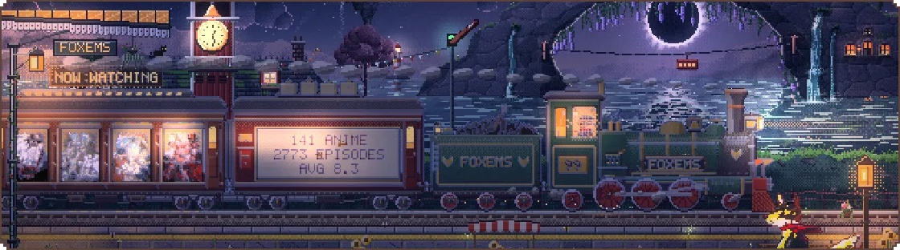</a>

 

Thirty palettes, from **Ember** and **Cyberpunk** to **Rose Pine Dawn**, switched with animated pixel-pour transitions.
Every color in the UI, the 3D fox, and the background world re-dresses itself in one click.

<a href="https://foxems.github.io/?scene=vinland&theme=ember&boot=0&sky=night">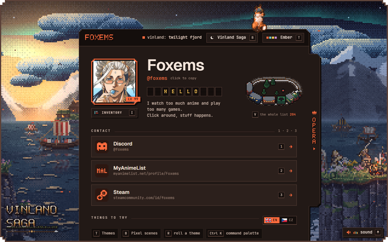</a>

<a href="https://foxems.github.io/?scene=orrery&theme=dracula&boot=0&sky=night">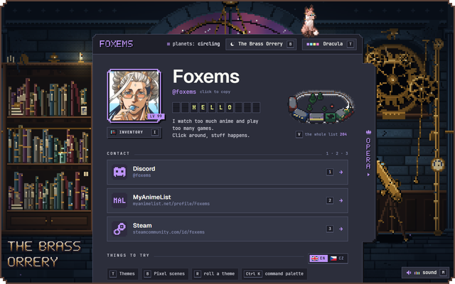</a>
<a href="https://foxems.github.io/?scene=sakura&theme=rose-pine&boot=0&sky=day">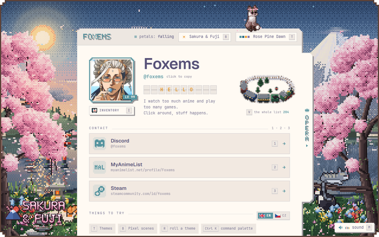</a>

<b>All 30 palettes</b>

 

Hackerman · Tokyo Night · Catppuccin · Gruvbox Dark · Matte Black · Ethereal · Everforest · Kanagawa · Last Horizon · Lumon · Miasma · Nord · Osaka Jade · Retro 82 · Ristretto · Solitude · Vantablack · Dracula · Synthwave '84 · Cyberpunk · Ember · Amber CRT · Matcha · Abyss · Cobalt · White · Flexoki Light · Rose Pine Dawn · Catppuccin Latte · Lupine

 

Synced from MyAnimeList and Steam into the site's pixel-art sprite sheets.

 

Desktop apps, terminal tools, 3D pixel toys, and custom renderers — whatever the idea needs. The site itself runs with
**zero build step and zero frameworks**, hand-drawn into HTML5 canvases one pixel at a time.

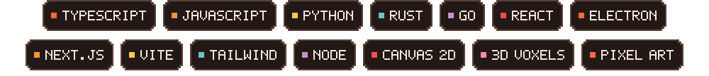

 

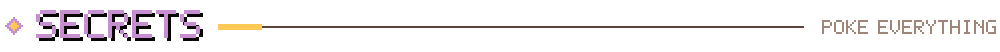

<b>Keyboard shortcuts on foxems.github.io</b>

 

| Key | Action |
|:-:|:--|
| <kbd>T</kbd> | flip through all 30 color themes |
| <kbd>R</kbd> | roll a random theme |
| <kbd>B</kbd> | open the 15-scene world picker |
| <kbd>F</kbd> | unbox the Top 10 3D relic booster packs |
| <kbd>I</kbd> | open the 3D PC rig & battlestation inventory |
| <kbd>V</kbd> | ride the steam train through all 204 titles |
| <kbd>O</kbd> | enter **Crown of Embers** (pixel-art opera, headphones on) |
| <kbd>M</kbd> | open the live Sound Deck mixer |
| <kbd>H</kbd> | hide the UI for pure pixel wallpaper mode |
| <kbd>Ctrl</kbd> + <kbd>K</kbd> | command palette |

<b>Things to poke</b>

 

The 3D fox on the window ledge (it wears a custom outfit for every scene). The cliff in Vinland Saga to trigger the
duel. The planets of the Brass Orrery. The neon towers in Night City. The train locomotive. The 3D Crown of Embers.
If something looks like it might react, it probably does.

 

