

<a href="https://foxems.github.io/">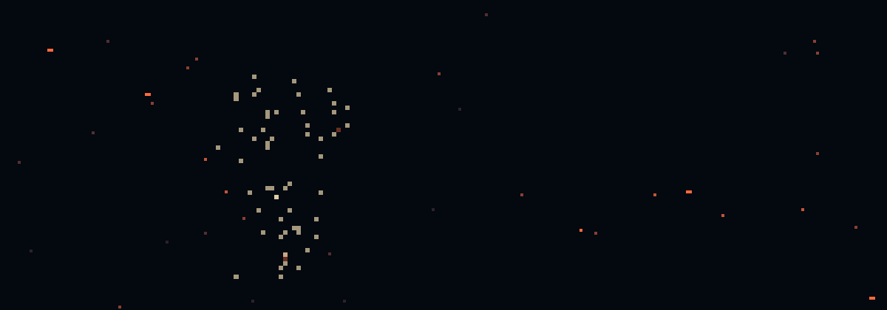</a>

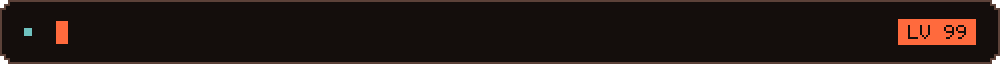

 

<a href="https://foxems.github.io/"></a>
&nbsp;
 
<a href="https://myanimelist.net/profile/Foxems"></a>
&nbsp;
<a href="https://steamcommunity.com/id/foxems"></a>

 

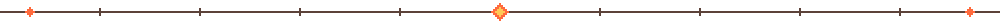

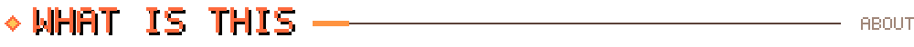

**Hi, I'm Foxems.** I watch too much anime and play too many games, and somewhere in between I made a website that
is less of a page and more of a toy. There's a pixel-art world in the background, a fox sitting on the edge of the
window, a train carrying everything I've watched and played, and a lot of small things that only happen if you poke them.

> [!TIP]
> It's not a normal "about me" page. **[Open it](https://foxems.github.io/) and click around**, most things react.

 

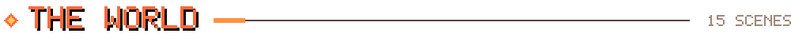

Fifteen living pixel worlds, each with its own weather and creatures, and a day and a night version. A whale breaches,
a dragon crosses the sea, a fire salamander smoulders in the lava, jellyfish drift through a nebula. **Click any scene to
step into it.**

<a href="https://foxems.github.io/?scene=sea&boot=0">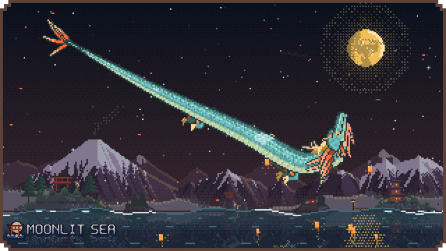</a>
<a href="https://foxems.github.io/?scene=sakura&boot=0">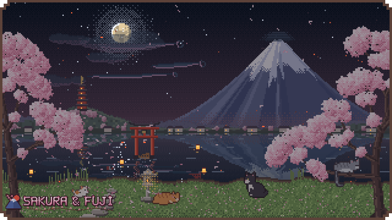</a>
<a href="https://foxems.github.io/?scene=bamboo&boot=0">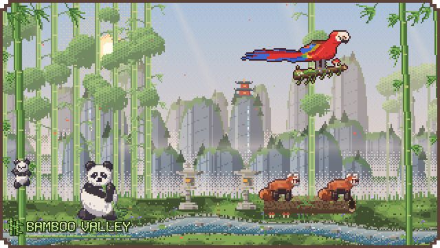</a>
<a href="https://foxems.github.io/?scene=reef&boot=0">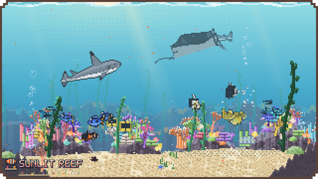</a>
<a href="https://foxems.github.io/?scene=volcano&boot=0">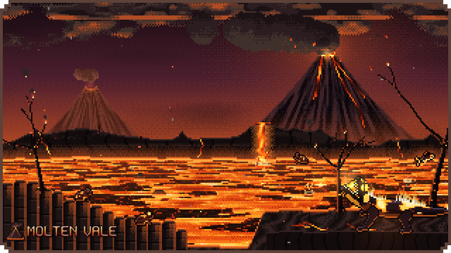</a>
<a href="https://foxems.github.io/?scene=city&boot=0">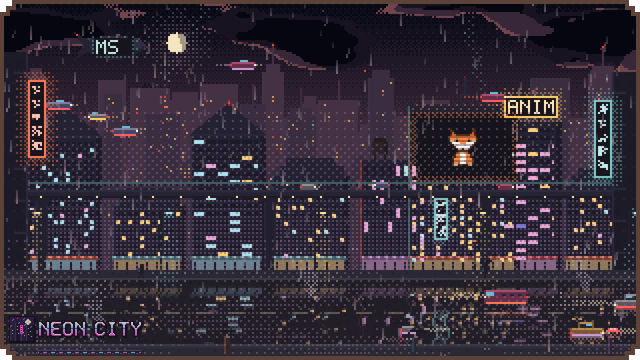</a>
<a href="https://foxems.github.io/?scene=blackhole&boot=0">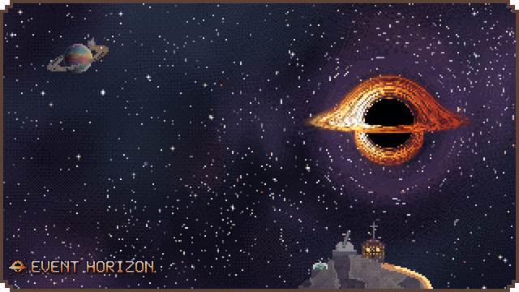</a>
<a href="https://foxems.github.io/?scene=earth&boot=0">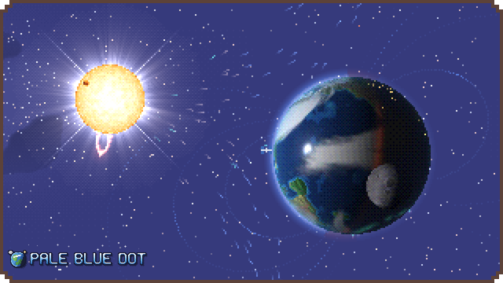</a>
<a href="https://foxems.github.io/?scene=nebula&boot=0">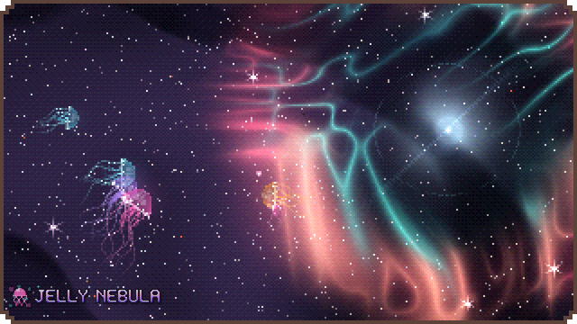</a>
<a href="https://foxems.github.io/?scene=galaxies&boot=0">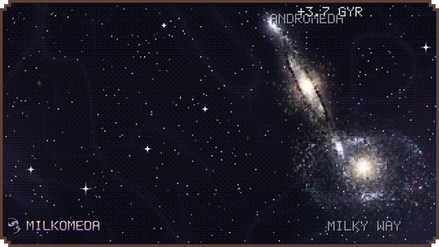</a>
<a href="https://foxems.github.io/?scene=lake&boot=0">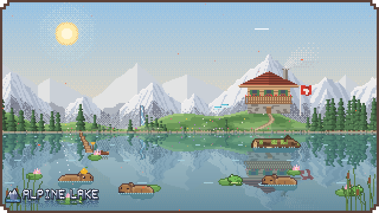</a>
<a href="https://foxems.github.io/?scene=forest&boot=0">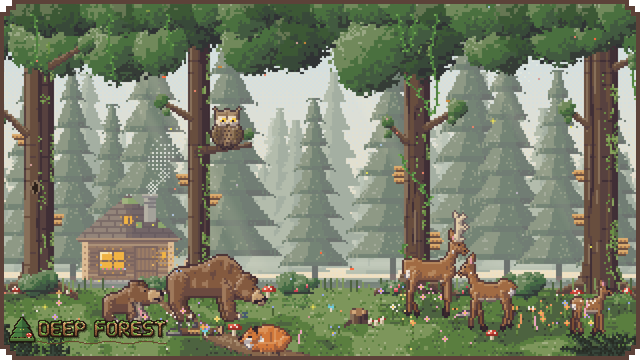</a>
<a href="https://foxems.github.io/?scene=fields&boot=0">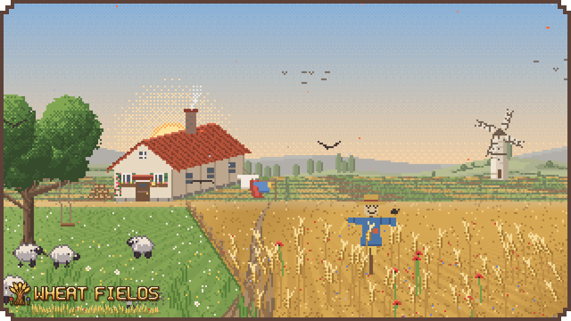</a>
<a href="https://foxems.github.io/?scene=isles&boot=0">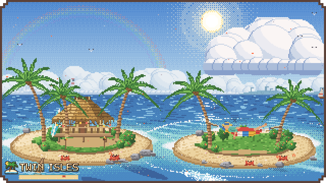</a>
<a href="https://foxems.github.io/?scene=lagoon&boot=0">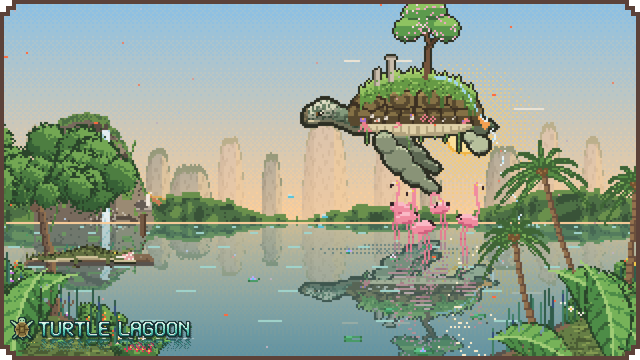</a>

 

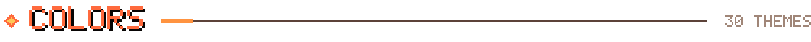

Thirty palettes, from Hackerman to Rose Pine Dawn, flipped through with live previews. Every colour on the site is a
palette token, so the whole world re-dresses itself in one click.

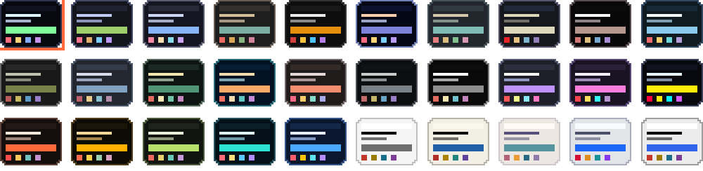

<a href="https://foxems.github.io/?scene=volcano&theme=ember&boot=0&sky=night">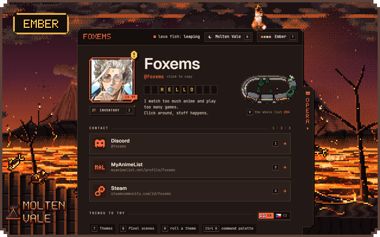</a>
<a href="https://foxems.github.io/?scene=city&theme=cyberpunk&boot=0&sky=night">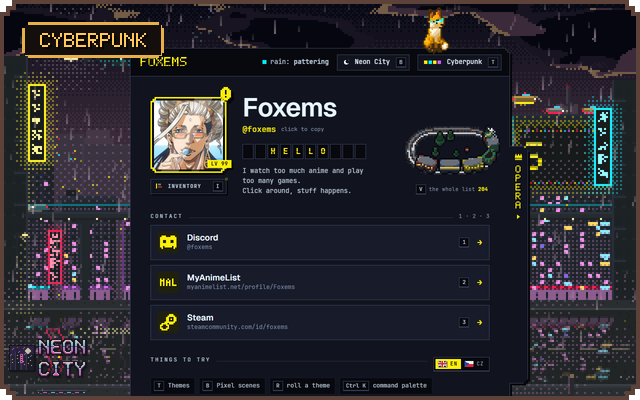</a>
<a href="https://foxems.github.io/?scene=galaxies&theme=dracula&boot=0&sky=night">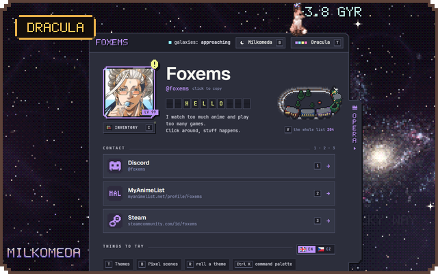</a>
<a href="https://foxems.github.io/?scene=lake&theme=flexoki-light&boot=0&sky=day">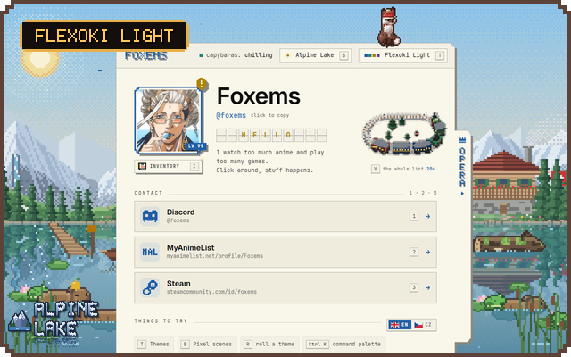</a>

All 30 palettes

 

Hackerman · Tokyo Night · Catppuccin · Gruvbox Dark · Matte Black · Ethereal · Everforest · Kanagawa · Last Horizon · Lumon · Miasma · Nord · Osaka Jade · Retro 82 · Ristretto · Solitude · Vantablack · Dracula · Synthwave '84 · Cyberpunk · Ember · Amber CRT · Matcha · Abyss · Cobalt · White · Flexoki Light · Rose Pine Dawn · Catppuccin Latte · Lupine

 

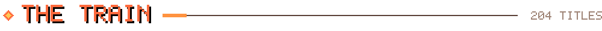

Every anime from my MyAnimeList and every game from my Steam library, one cover per window, riding through the night.
Stop it, drag it, search it, poke the engine.

<a href="https://foxems.github.io/">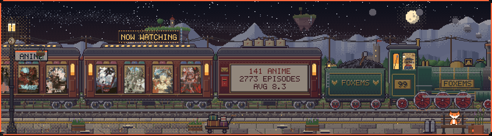</a>

 

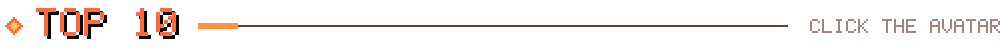

Click the avatar and it breaks apart into its own pixels, which land in ten living covers: my five favourite anime
and my five favourite games. Double-click a card to flip it.

<a href="https://foxems.github.io/">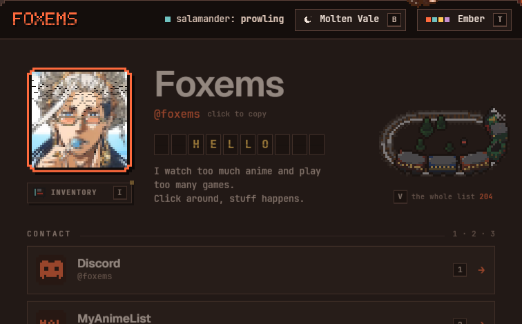</a>

| | Anime | Games |
|:-:|:--|:--|
| **1** | Code Geass: Lelouch of the Rebellion | Red Dead Redemption 2 |
| **2** | Vinland Saga | Kingdom Come: Deliverance II |
| **3** | Fullmetal Alchemist: Brotherhood | Crimson Desert |
| **4** | Attack on Titan | God of War Ragnarök |
| **5** | Bleach | Clair Obscur: Expedition 33 |

 

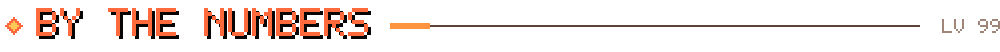

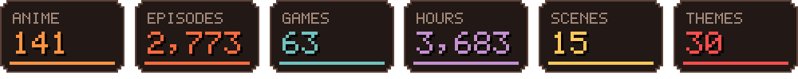

Synced from MyAnimeList and Steam into the site's pixel-art sprite sheets.

 

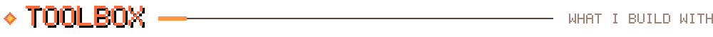

Desktop apps, terminal tools, web toys: whatever the idea needs. The website itself has no build step and no
dependencies, just static files, hand-drawn into canvases one pixel at a time.

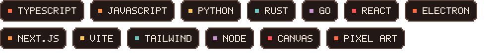

 

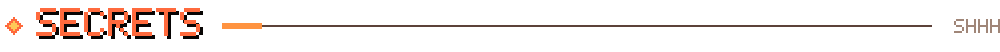

<b>Keyboard shortcuts on the site</b>

 

| Key | Does |
|:-:|:--|
| <kbd>T</kbd> | flip through the color themes |
| <kbd>R</kbd> | roll a random theme |
| <kbd>B</kbd> | pick a pixel scene |
| <kbd>F</kbd> | open the top 10 |
| <kbd>V</kbd> | the whole list, on the train |
| <kbd>I</kbd> | the inventory |
| <kbd>O</kbd> | the opera: an orchestra and a choir in pixel art, about two minutes, headphones on |
| <kbd>M</kbd> | sound |
| <kbd>Ctrl</kbd> + <kbd>K</kbd> | command palette |

<b>Things to poke</b>

 

The fox. The engine of the train. The dragon, the koi, the telescope. The avatar.
If something looks like it might do something, it probably does.

 


